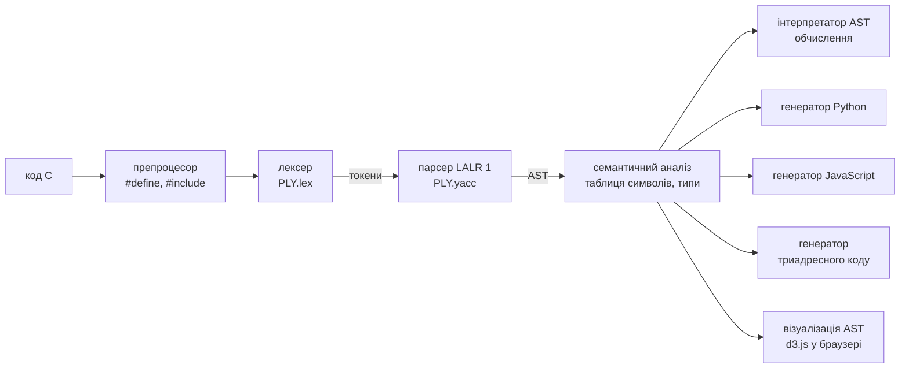

# MiniC — компілятор підмножини мови C на базі Lex/Yacc (PLY)

Синтаксичний аналізатор мови **C** (C89/C99-підмножина), побудований генератором
**LALR(1)**-аналізаторів **PLY** (Python Lex-Yacc — повний аналог Lex/Yacc: ті самі
регулярні вирази для токенів, ті самі BNF-правила з семантичними діями, таблиці
пріоритетів `%left/%right/%nonassoc/%prec`, файл опису автомата `parser.out` ≈ `y.output`).

Проєкт містить повний конвеєр компілятора:



## Відповідність критеріям оцінювання

| Критерій | Що реалізовано |
|---|---|
| Коректний робочий проєкт | CLI + веб-інтерфейс, 15 прикладів, 28 автотестів, крос-перевірка трьох виконавців |
| Відповіді на питання по коду | [`docs/DEFENSE_QA.md`](docs/DEFENSE_QA.md) — де що лежить і як працює |
| **Граматика мови C** | [`minic/parser.py`](minic/parser.py): 169 продукцій, 52 нетермінали, 276 станів LALR, **0 конфліктів**; декларатори C (`int *p`, `int a[3][4]`, прототипи), усі оператори C, 15 рівнів пріоритету виразів |
| Теорія: LALR, yacc, конфлікти | [`docs/THEORY.md`](docs/THEORY.md) + живі демонстрації: [`tools/conflicts_demo.py`](tools/conflicts_demo.py), вкладки «LALR-протокол» і «Граматика» у веб-інтерфейсі |
| Семантика / обчислення AST | [`minic/semantic.py`](minic/semantic.py) (типи, області видимості, 20+ видів помилок) + [`minic/interpreter.py`](minic/interpreter.py) (виконання з вказівниками, переповненням int, контролем меж масивів) |
| Генерація коду на цільовій мові | Трансляція у **Python** ([`codegen_python.py`](minic/codegen_python.py)) і **JavaScript** ([`codegen_js.py`](minic/codegen_js.py)) + проміжний **триадресний код** ([`codegen_tac.py`](minic/codegen_tac.py)) |
| Візуалізація AST у браузері (JS-графіка) | [`web/app.js`](web/app.js): **d3.js** — інтерактивне дерево (згортання, масштаб, підказки, зв'язок з рядками коду, експорт SVG) і **анімація побудови AST знизу-вгору в порядку згорток LALR** |

## Швидкий старт

Потрібен лише Python ≥ 3.8 і пакет `ply`.

```bash
pip install -r requirements.txt
```

```bash
python minic.py --serve
```

Відкриється `http://127.0.0.1:8765/` — редактор коду, AST, виконання, згенерований код,
токени, таблиця символів, протокол LALR-розбору та статистика граматики.
(Windows: можна просто запустити `run_web.bat`.)

### Командний рядок

```bash
python minic.py examples/02_factorial.c
```

```bash
python minic.py examples/02_factorial.c --ast --tokens --symbols
```

```bash
python minic.py examples/07_switch.c --py out.py --js out.js --tac -
```

```bash
python minic.py examples/01_hello.c --trace --no-run
```

```bash
python minic.py --grammar
```

| Опція | Дія |
|---|---|
| `--tokens` | потік токенів (тип, лексема, рядок:стовпець) |
| `--ast` | AST у вигляді дерева з типами |
| `--symbols` | таблиця символів |
| `--trace` | протокол LALR-автомата: стан, стек, lookahead, shift/reduce |
| `--py FILE` / `--js FILE` / `--tac FILE` | згенерувати код (`-` — у консоль) |
| `--json FILE` | AST у JSON (формат для `d3.hierarchy`) |
| `--grammar` | кількість станів, продукцій, конфліктів; список правил |
| `--serve [--port N]` | веб-інтерфейс |

### Тести і перевірки

```bash
python -m unittest discover -s tests -v
```

```bash
python tools/crosscheck.py
```

```bash
python tools/conflicts_demo.py
```

* `tests/test_minic.py` — 28 тестів: лексер, пріоритети/асоціативність, висячий else,
  відновлення після помилок, семантичні помилки, інтерпретатор, еталонний вивід усіх прикладів,
  **вивід згенерованого Python і JavaScript збігається з інтерпретатором**.
* `tools/crosscheck.py` — для кожного прикладу запускає інтерпретатор, згенерований Python
  та згенерований JS (Node.js або Deno) і порівнює вивід.
* `tools/conflicts_demo.py` — демонстрація shift/reduce і reduce/reduce конфліктів, їх
  розв'язання пріоритетами, та граматики, яка є LR(1), але не LALR(1).

## Підтримувана підмножина C

* **Типи:** `void char short int long float double`, `signed/unsigned`, `const`, `static/extern`,
  вказівники `T*`, `T**`, багатовимірні масиви `T a[N][M]`, параметри-масиви `int a[]`, `int m[][N]`.
* **Оголошення:** глобальні/локальні змінні, кілька деклараторів `int a = 1, *p, b[3];`,
  ініціалізатори `{...}` (вкладені та «плоскі»), `char s[] = "..."`, виведення розміру `int a[] = {...}`,
  прототипи функцій, `f(void)`.
* **Оператори:** блоки з областями видимості, `if/else`, `while`, `do-while`, `for` (з оголошенням
  у `init`), `switch/case/default` з fallthrough, `break`, `continue`, `return`.
* **Вирази:** усі 15 рівнів пріоритету C — `,` `= += -= *= /= %= <<= >>= &= ^= |=` `?:` `||` `&&` `|` `^` `&`
  `== !=` `< > <= >=` `<< >>` `+ -` `* / %` приведення `(type)`, унарні `& * + - ~ ! ++ -- sizeof`,
  постфіксні `[] () ++ --`; рядкові/символьні літерали з escape-послідовностями, hex/octal-константи.
* **Препроцесор:** `#include` (ігнорується), `#define NAME value`.
* **Бібліотека:** `printf` (формати `%d %i %u %x %o %c %s %f %e %g %%`, ширина/точність/прапорці),
  `puts putchar strlen abs fabs sqrt pow floor ceil exit`.

Свідомо не реалізовано: `struct/union/enum`, `typedef` (вимагає «lexer hack» — див. теорію),
`goto`, функціональні макроси, вказівники на функції.


## Обмеження трансляції

Інтерпретатор AST і TAC підтримують **усі** конструкції, включно з вказівниками.
У Python/JavaScript немає адрес змінних, тому `&x` для скалярів і арифметика вказівників при
трансляції повідомляють про обмеження (`*a` та `*(a + i)` для масивів перетворюються на `a[0]`, `a[i]`).
Переповнення 32-бітного `int` емулює лише інтерпретатор (у Python цілі необмежені, у JS — double).
